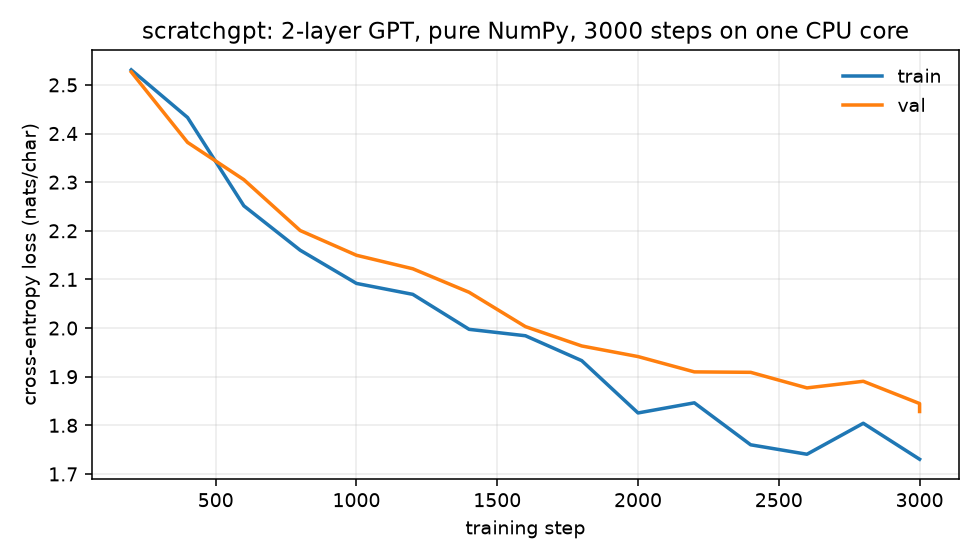

# scratchgpt

A small GPT written in NumPy, including its own little autograd engine, so I could see every piece of the training loop instead of calling into PyTorch. The repo has a trained character-level model on TinyShakespeare (419,328 parameters) that you can sample right away.

```bash
pip install -e '.[dev]'

python -m scratchgpt.sample --ckpt checkpoints/final.npz \
  --data data/tinyshakespeare.txt --prompt 'JULIET:' \
  --n 400 --temperature 0.8 --top-k 20

python -m scratchgpt.train --data data/tinyshakespeare.txt --out runs/base --steps 3000
```

The model is 2 layers, 4 heads, width 128, 65-character vocab. After 3,000 steps on CPU the validation loss was 1.83 nats per character. It picks up the shape of a play but not much sense:

```text
JULIET:
Sto hid, if heary sweet and so had clauden, or more am buto some
Compen to too dess to kince of Richord, but now way.

PARINCE:
Bit is my lord, hold well, you ammile, or murder.
```



## Where things live

- `tensor.py`: reverse-mode autograd
- `nn.py`, `model.py`: embeddings, causal attention blocks, LM head
- `optim.py`: Adam
- `train.py`, `checkpoint.py`: training loop and checkpoints
- `sample.py`: temperature / top-k sampling

## Side experiments

After the base model worked I kept adding things to learn how they work:

- Resumable training: the checkpoint saves RNG and Adam state so a run can stop and pick up at the same step. Notes in CONTINUATION.md.
- Activation recomputation: drop the insides of each block in the forward pass and rebuild them during backward. Notes in REMATERIALIZATION.md.
- KV cache for generation (`scratchgpt.cache_audit`). Funny result: at full context, cached was 253 ms vs 251 ms for plain full forward over 48 steps on my machine, because the window keeps shifting and the cache gets rebuilt. It only helps with short prompts. Notes in CACHE.md.

Each has a little browser page under https://midya8.github.io/scratchgpt/.

## Tests

`python -m pytest -q` runs 162 tests. One of them (`test_shipped_checkpoint_every_step_through_rollover`) compares float32 logits with a 1e-5 tolerance and can be off by a hair depending on your BLAS.

It's an educational CPU implementation, not something to serve. MIT licensed; TinyShakespeare is public domain.
