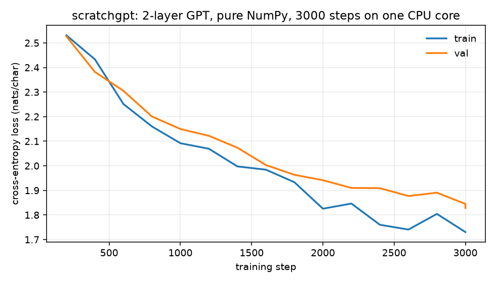

# scratchgpt

[](https://github.com/midya8/scratchgpt/actions/workflows/ci.yml)
[](LICENSE)

A small GPT in NumPy, from reverse-mode differentiation to training and inference.
The repository includes a trained 419,328-parameter character model, an
exact-continuation trainer, activation rematerialization and a KV-cache path.
No PyTorch, JAX, model service or API key is required.

The useful part is being able to inspect the work: restart at every training
boundary, rebuild a discarded transformer block during backward, or compare
every cached key, value and logit with a full forward.

## Run it

```bash
pip install -e '.[dev]'

# Sample the committed model.
python -m scratchgpt.sample --ckpt checkpoints/final.npz \
  --data data/tinyshakespeare.txt --prompt 'JULIET:' \
  --n 400 --temperature 0.8 --top-k 20

# Train a new model. Runtime depends on your machine and BLAS settings.
python -m scratchgpt.train --data data/tinyshakespeare.txt \
  --out runs/base --steps 3000

python -m pytest -q
node --test tests/test_*.cjs
```

## Three experiments

### Exact continuation

[Browser workbench](https://midya8.github.io/scratchgpt/) · [Contract and reproduction](CONTINUATION.md)

Save train/evaluation RNG state, Adam buffers and step, data identity, numerical
options and runtime metadata. The bounded synthetic audit resumes at all 13
boundaries and shows what breaks when RNG or optimizer state is missing. Its
independent browser engine checks Adam coordinates and transformer forwards.
This is not a cross-machine determinism promise. Old inference checkpoints can
still be sampled, but cannot restore a training trajectory.

### Activation rematerialization

[Full-backward workbench](https://midya8.github.io/scratchgpt/remat.html) · [Execution details](REMATERIALIZATION.md)

Keep transformer-block boundaries and rebuild the interiors during backward.
The opt-in path uses the original block code and upstream derivative; it does
not change the default trainer. Inspect execution order, every parameter
gradient and one-step SGD arithmetic in the separate scalar-autograd browser
model. It supports deterministic dropout-zero, first-order gradients with
unchanged inputs and weights. Graph diagnostics are logical element/node
counts, not peak memory or measured speed.

### Cached inference

[Cache workbench](https://midya8.github.io/scratchgpt/cache.html) · [Cache contract, timings and reproduction](CACHE.md)

An inference-only float32 weight snapshot reuses earlier keys and values while
the context grows. Once the learned-position window shifts, it rebuilds the
whole final window. The workbench executes an independent cached model and a
full-forward reference, exposes all KV/logit coordinates and includes a
wrong-shift control. Editable complete inputs can be downloaded and replayed
against the original native GPT.

The archived three-arm benchmark keeps the losing case: at full context,
NumPy cached takes 253.230 ms versus 251.783 ms for NumPy full over 48
teacher-forced steps in this local run. Short prompts avoid repeated projections;
they do not establish a general speed guarantee. The original sampler remains
unchanged. Close float32 logits are not a promise of identical sampled tokens.

```bash
python -m scratchgpt.cache_audit --fixture > input.json
python -m scratchgpt.cache_audit input.json > report.json
python scripts/build_cache.py --check
PYTHON=python bash examples/verify_cache_wheel.sh
```

## What is checked

The current suite has **158 Python tests** and **13 Node/Chrome tests**. All 111
Python tests from the rematerialization release remain. The new 47 cover cache
boundaries, causality, ownership, rolling windows, malformed inputs and the
three-arm benchmark without a speed gate.

| Experiment | Reproducible evidence | Important limit |
| --- | --- | --- |
| Continuation | 13 restart boundaries; independent Adam and forward checks; installed separate-process resume | Same validated data/options/numerical environment |
| Rematerialization | 18 complete controls; 15,184 parameter positions; all 419,328 shipped-checkpoint parameter gradients for both block groupings | No stochastic replay, higher-order gradients or memory/speed claim |
| Cache | 8 complete controls; 43 steps; 685 cached logits; 3,256 KV coordinates; every displayed coordinate checked in Chrome; installed checkpoint rollout | Synthetic browser controls; original checkpoint tested separately; float32/float64 compared within tolerance |

The Chrome checks include trusted input edits, stale-output invalidation,
320/390/1280-pixel layouts and real input/report downloads. Installed-wheel
checks run outside the checkout. See each experiment's document for definitions,
tolerances, exclusions and the commands that rebuild its evidence.

## The original trained model

The committed checkpoint has two layers, four heads, width 128 and a
65-character vocabulary. Its file SHA-256 is
`3de6a1626e4489a2e0bc867fc58fe66d323ac6c527bb3af7be662b49510a817e`.
The historical loss log ends at step 3,000 with validation loss 1.8284 nats per
character. There are two evaluation rows at step 3,000, not a confidence interval.
The later experiments do not retrain this checkpoint or establish convergence.



An excerpt from the committed sample at temperature 0.8 and top-k 20:

```text
JULIET:
Sto hid, if heary sweet and so had clauden, or more am buto some
Compen to too dess to kince of Richord, but now way.

PARINCE:
Bit is my lord, hold well, you ammile, or murder.
```

It learns some character-level structure but does not produce reliable prose.
Earlier runtime/RSS figures are not used as current benchmark results. The new
cache record states its software/thread settings, retains every timed repeat
and does not record a CPU model.

## Code map

| File | Role |
| --- | --- |
| `scratchgpt/tensor.py` | Reverse-mode autograd and array-operation backward rules |
| `scratchgpt/nn.py`, `model.py` | Embeddings, pre-LN causal transformer blocks, learned positions and language-model head |
| `scratchgpt/optim.py` | Adam with bias correction |
| `scratchgpt/train.py`, `checkpoint.py` | Training, exact continuation, bounded no-pickle loading and atomic saves |
| `scratchgpt/sample.py` | Original temperature/top-k sampler |
| `scratchgpt/remat.py`, `remat_audit.py` | Optional block recomputation and full-gradient audit |
| `scratchgpt/inference.py`, `cache_audit.py`, `cache_benchmark.py` | Copied inference weights, cache audit and local three-arm timing |
| `docs/`, `tests/`, `examples/` | Independent browser engines, frozen controls, regression tests and installed-wheel reproduction |

This is an educational CPU implementation, not a production inference server.
Transformer attention, Adam, activation checkpointing and KV caching are prior
work, attributed in the experiment documents. No new method or downstream
quality gain is claimed.

## License

MIT. The bundled TinyShakespeare text is public domain.
